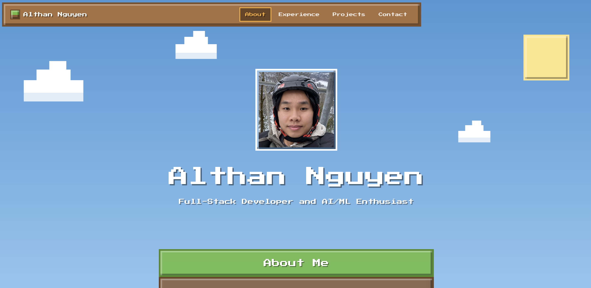

# Minecraft Themed Portfolio



This is a Minecraft themed portfolio site that allows people to display their current experiences and projects. 

## Table of Contents 

- [Background](#background)
- [Installation](#installation)
- [Usage](#usage)
- [Contributing](#contributing)
- [License](#licence)


## Background

I always wanted to create a portfolio site, but I also wanted it to be more personable, since I didn't want it to be a plain portfolio. 
This made me want to make one inspired by Minecraft, a game I enjoyed playing growing up. This project helped display my work and experience
in an easy manner while doing it in a fun way. For the minecraft theme, I used Tailwind CSS to help design, and Lucide Reacts for their icons.

## Installation

To clone and use this repository, you need to make sure you have node.js, git, and VSCode installed on your computer. 
Once you have those installed, you can run these commands in the command line interface.
```bash
# This will clone the repository
git clone https://github.com/AlthanN/minecraftPortfolio.git

# This allows you to open up that directory folder
cd minecraftPortfolio

# This will install the required dependencies
npm install

# This will run a developmental server on your local device, with a url to view
npm start
```

## Usage

Primary usage is simply running the server, and modifying its contents in the lib folder with the file: portfolio-data.ts.

## Contributing 

For any questions, you can contact the owner of the site, Althan Nguyen through linkedin. PR requests can be accepted if 
there is genuine interest and feedback that could be applied for this portfolio project. For requirements, you must have
detailed and informed commits and a pr request for it to be considered.

## License 

It is unlicensed


